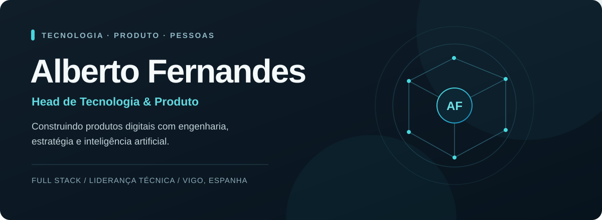

<div align="center">



<a href="https://albertohf.vercel.app/">
  
</a>
<a href="https://www.linkedin.com/in/albertohfernandes/">
  
</a>


</div>

## 💻 Sobre mim

Sou Alberto, tenho **35 anos** e atuo há **7 anos como desenvolvedor**. Minha trajetória passa pelo desenvolvimento web e mobile, arquitetura de software, liderança técnica e gestão de produto.

Atualmente sou **Head de Tecnologia & Produto no Grupo Aiyô**, onde trabalho na estratégia técnica e de produto, arquitetura, integração de serviços e evolução da plataforma. Também me interesso por automações inteligentes e agentes de IA e estou estudando **cybersecurity**.

```text
┌─[ alberto@dev ]────────────────────────────────┐
│                                                │
│  Localização  →  Vigo, Galiza, Espanha         │
│  Experiência  →  7 anos em desenvolvimento     │
│  Áreas        →  Engenharia, produto e IA      │
│  Estudando    →  Cybersecurity                 │
│                                                │
└────────────────────────────────────────────────┘
```


## 🛠️ Tecnologias e ferramentas

<div align="center">


</div>

## 🧭 Experiência

| Empresa | Cargo | Período |
| --- | --- | --- |
| **Grupo Aiyô** | Head de Tecnologia & Produto | ago. 2026 – atual |
| **Grupo Aiyô** | Staff Full Stack Engineer | jan. 2026 – out. 2026 |
| **Dizevolv** | Tech Lead | jun. 2025 – nov. 2025 |
| **CanastraDigital** | Founder | mai. 2024 – nov. 2025 |
| **AEX** | Consultor Tech | set. 2024 – ago. 2025 |
| **SouJunior Labs** | Product Owner e Scrum Master | mar. 2024 – jul. 2024 |
| **M3, a Cadastra Company** | Desenvolvedor Front-end | nov. 2022 – set. 2023 |
| **we.digi** | Desenvolvedor Front-end VTEX IO | ago. 2022 – nov. 2022 |
| **Jukebox** | Desenvolvedor Front-end Jr. | out. 2021 – ago. 2022 |

Na liderança técnica, participei de decisões de arquitetura, revisão de código e mentoria. Em produto, trabalhei com discovery, backlog, roadmap e colaboração com equipes de desenvolvimento.


## 🎓 Formação e aprendizado

- **Análise e Desenvolvimento de Sistemas** — Faculdade UniBF
- **Programação Full Stack** — DevPleno
- **Desenvolvimento Full Stack e VTEX IO** — Gama Academy
- **Liderança e Gestão de Pessoas** e **Empreendedorismo, Negócios e Startups** — Fast MBA
- **Em estudo:** cybersecurity

## 🤝 Vamos nos conectar?

Gosto de trocar ideias sobre desenvolvimento, produto, inteligência artificial e segurança. Conheça meu [portfólio](https://albertohf.vercel.app/) ou me encontre no [LinkedIn](https://www.linkedin.com/in/albertohfernandes/).

<div align="center">

**⚡ Construindo, aprendendo e evoluindo uma linha de código por vez.**


</div>
